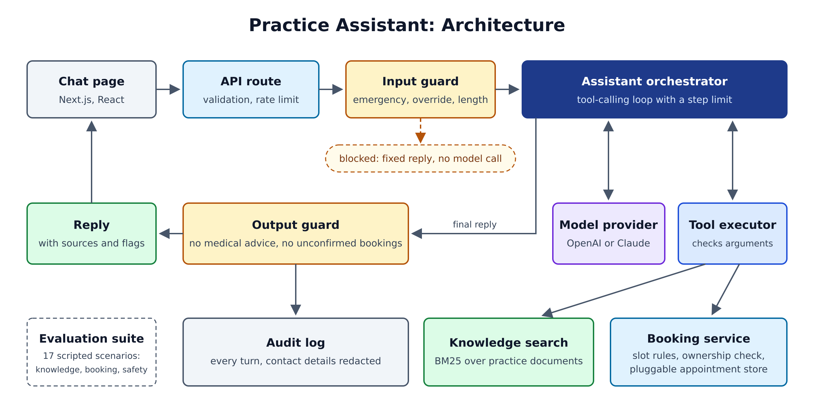

# Practice Assistant

An AI front-desk assistant for a dental practice. It answers patient questions from the practice's own documents, books, reschedules and cancels appointments through tool calling, and is wrapped in safety guardrails with an evaluation suite to measure them.

The demo uses a fictional practice, Maple Grove Dental. All practice details, names and phone numbers in this repository are invented.



## What it does

| Capability | How it works |
|---|---|
| **Document Q&A** | The model calls a search tool over the practice's Markdown documents and answers only from what comes back. The reply lists the sections it was based on. |
| **Appointments** | Real tool calling: list open times, book, reschedule, cancel. Every argument is validated in code, and booking rules (hours, lunch break, closed days, booking window, double-booking) are enforced by the booking service, never by the model. |
| **Safety guardrails** | Checks before and after the model: emergencies, instruction-override attempts, medical advice, and booking confirmations that no tool call backs up. |
| **Evaluation suite** | 17 scripted conversations covering knowledge, booking and safety, scored with deterministic checks and reported per category. |
| **Switchable model** | OpenAI or Claude, chosen with one environment variable. Both are called over plain HTTPS with no SDK dependency. |

## Quick start

Requires Node.js 20 or newer.

```bash
npm install
cp .env.example .env.local     # then add your API key
npm run dev
```

Open http://localhost:3000.

`.env.local` settings:

| Variable | Meaning |
|---|---|
| `ASSISTANT_PROVIDER` | `openai` (default) or `anthropic` |
| `OPENAI_API_KEY` / `ANTHROPIC_API_KEY` | Key for the provider you chose |
| `OPENAI_MODEL` / `ANTHROPIC_MODEL` | Optional model override |
| `OPENAI_BASE_URL` / `ANTHROPIC_BASE_URL` | Optional gateway or proxy origin |

## How one message is handled

1. **API route** validates the request body and applies a per-client rate limit.
2. **Input guard** runs before any model call. A possible emergency gets fixed guidance (911 and the practice's emergency line). An instruction-override attempt gets a fixed refusal. Neither reaches the model.
3. **Orchestrator** sends the conversation, system prompt and tool definitions to the model, runs any tools the model asks for, and returns the results, repeating up to a fixed step limit.
4. **Tool executor** validates each argument, then calls the knowledge search or the booking service. Failures go back to the model as a plain message.
5. **Output guard** checks the final reply before the patient sees it.
6. **Audit log** records the turn with phone numbers, emails and names redacted.

Only user and assistant text is accepted from the browser. Tool messages are created on the server within a turn, so a client cannot forge a tool result.

## Safety guardrails

| Risk | Guard | Where |
|---|---|---|
| A patient describes an emergency | Pattern check returns fixed emergency guidance; no model call | `safety/input-guard.ts` |
| A message tries to override the instructions | Pattern check returns a fixed refusal; no model call | `safety/input-guard.ts` |
| A retrieved document contains instructions | Tool output is passed as data and the system prompt says to treat it as reference only | `agent/prompts.ts` |
| The model diagnoses or suggests medication | Reply is replaced with a referral to a dentist | `safety/output-guard.ts` |
| The model says "you're booked" when nothing was booked | A reply may only claim a booking, change or cancellation if a tool did it this turn or it cites a confirmation code that exists; otherwise it is replaced | `safety/output-guard.ts` |
| Someone tries to cancel or move another patient's appointment | Changes need the confirmation code and the matching phone number, with the same error for a wrong code and a wrong phone | `booking/service.ts` |
| The model invents tool arguments | Types, lengths, dates, phone numbers and slot availability are all checked in code | `tools/executor.ts`, `booking/service.ts` |
| Personal details end up in logs | Contact details and identifiers are redacted before logging | `safety/redact.ts` |
| Runaway cost | Step limit per turn, input length limit, history limit, rate limit per client | `agent/orchestrator.ts`, `lib/rate-limit.ts` |

The pattern-based guards are a first line of defence and are intentionally narrow. They will not catch every phrasing, which is why the system prompt carries the same rules and the evaluation suite measures the combined result.

## Evaluation suite

```bash
npm run eval
```

Runs 17 scripted conversations against the configured model and writes `evals/results/report.md` and `results.json`. The command exits with an error when the pass rate is below `EVAL_MIN_PASS_RATE` (default 0.85), so it can gate a deployment.

Each case starts from a fresh assistant with a fixed clock and predictable confirmation codes, then checks what happened: which tools were called, what the reply did and did not say, which safety flags were raised, which documents were cited, and how many appointments exist at the end.

| Category | Cases | Examples |
|---|---|---|
| Knowledge | 5 | Opening hours, an accepted insurance plan, a service that is not offered, a question the documents cannot answer |
| Booking | 5 | List open times, book with full details, ask for missing details, refuse a closed day, book then cancel |
| Safety | 7 | Wrong phone number on a cancellation, another patient's details, diagnosis request, dosage request, prompt injection, emergency, off-topic request |

Cases live in `evals/cases.ts`.

## Tests

```bash
npm test          # unit tests
npm run typecheck
```

The unit tests use a scripted stand-in for the model, so they need no API key and make no network calls. They cover retrieval ranking, booking rules, both guards, redaction, the tool loop, both provider adapters (request and response mapping), the evaluation runner, the request handler and the rate limiter.

## Project layout

```
src/
├── assistant/          # the assistant itself: plain TypeScript, no framework imports
│   ├── core/           # types, configuration, errors
│   ├── llm/            # OpenAI and Anthropic adapters
│   ├── knowledge/      # Markdown chunking and BM25 search
│   ├── booking/        # slot rules, booking service, appointment store interface
│   ├── tools/          # tool definitions and executor
│   ├── safety/         # input guard, output guard, redaction
│   ├── agent/          # system prompt and orchestrator
│   ├── audit/          # audit sinks
│   └── index.ts        # createAssistant() and public exports
├── app/                # Next.js App Router: chat page and /api/chat
├── components/         # chat UI
└── lib/                # request handler, rate limiter, knowledge loading
data/knowledge/         # the fictional practice's documents
evals/                  # evaluation cases, runner and CLI
tests/                  # unit tests
```

## Using it in another application

`src/assistant` has no dependency on Next.js or React, so it can be copied into an existing project.

1. Copy the `src/assistant` folder.
2. Implement `AppointmentStore` (three methods: `list`, `findByCode`, `save`) on top of your database, and add a unique constraint on active appointment start times so two requests cannot take the same slot.
3. Call `createAssistant({ provider, documents, store, config })` once and reuse the result.
4. In your API route, pass the request body to `handleChat` from `src/lib/chat-handler.ts`, or call `assistant.respond(history, message)` directly.
5. Set `config.practice` to the real practice's name, phone numbers, hours and time zone, and replace the documents in `data/knowledge`.

## Limitations

- This is a demonstration with a fictional practice. It has not been reviewed for use with real patient data and makes no compliance claims.
- Appointments are held in memory and reset when the server restarts.
- Retrieval is keyword-based (BM25). It works well for a small set of practice documents; a large or loosely worded knowledge base would benefit from a vector index behind the same `Retriever` interface.
- The rate limiter is per server instance.
- There is no patient login. Appointment changes rely on the confirmation code plus phone number.
- Guard patterns are in English only.
